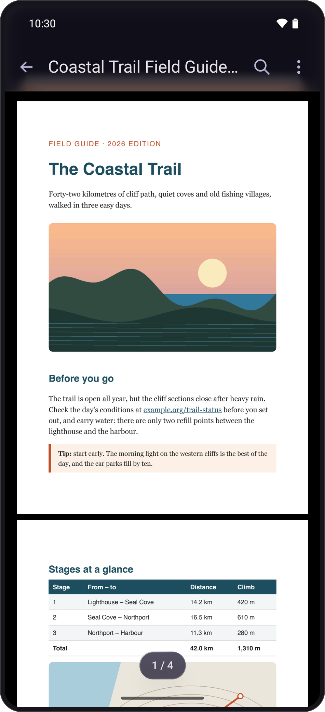
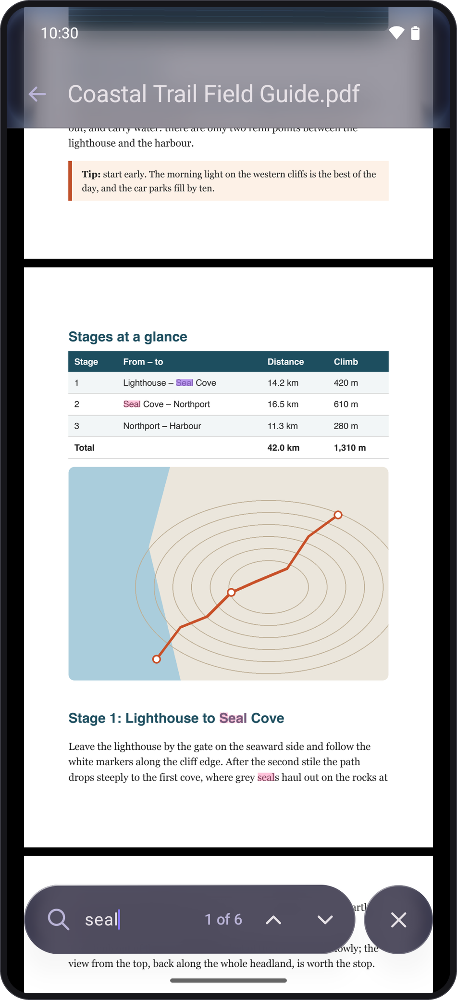
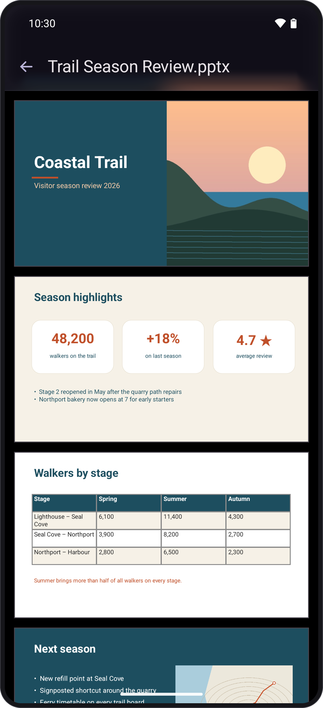
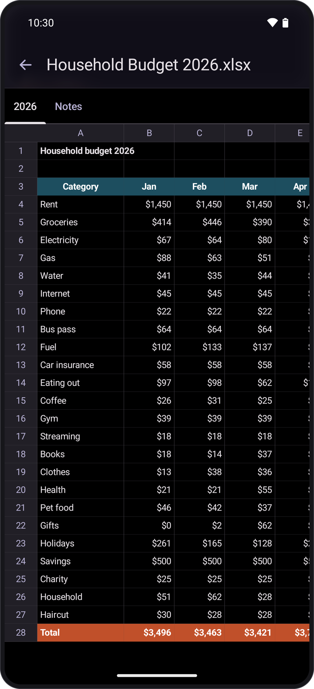
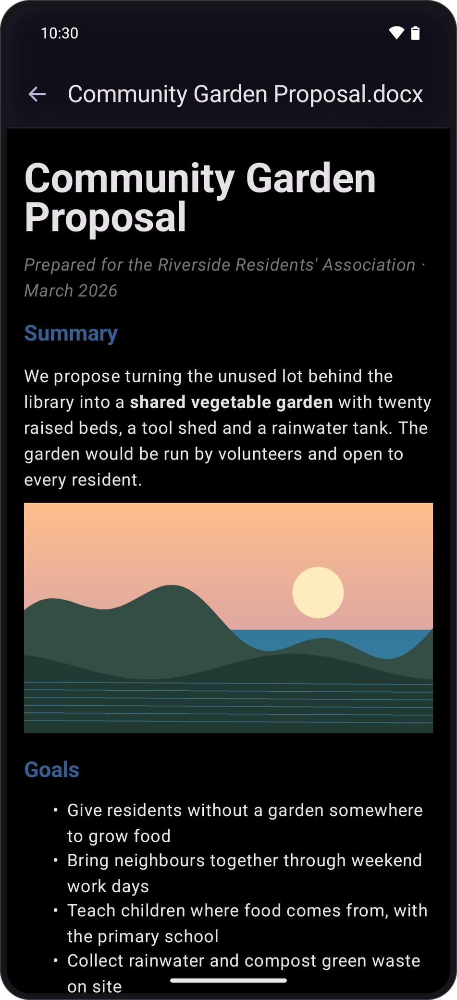
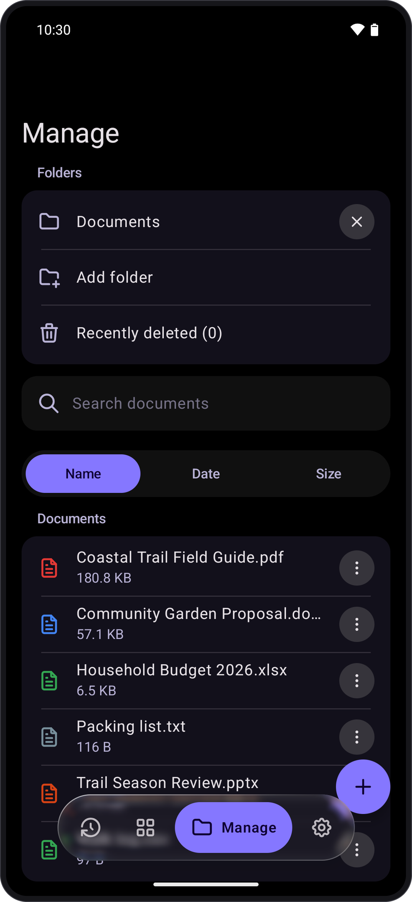

# Pvot Documents

A documents app that you need but is not provided to you: one private, offline place to open,
organize and work with the documents on your phone. Built on the
[Pvot design system](https://github.com/PVOT-OSS/PvotLib).

> **Status:** early. It opens PDF, Word, OpenDocument text, spreadsheets, slides and plain-text
> files, all view-only. Editing, the PDF tools and the scanner are not built yet.

## Screenshots

<p align="center">
  
  &nbsp;
  
  &nbsp;
  
</p>
<p align="center">
  
  &nbsp;
  
  &nbsp;
  
</p>

## Roadmap

| Phase | What it brings |
|---|---|
| 0. Scaffold | Project, PvotLib, app shell with Recent, Tools, Manage and Settings, CI |
| 1. Library | Folders through the system picker, "Open with" (with an autosave-or-not choice), recents with type filters, search, sort, list and grid, multi-select, share, rename, delete to Recently deleted, new file / scan from Tools |
| 2. Core viewers | PDF (zoom, thumbnails, search, go to page, night mode, resume), text, code, Markdown, CSV, HTML, JSON, DOCX |
| 3. Office formats | XLSX/ODS sheets, PPTX/ODP slides, ODT, possibly EPUB |
| 4. Editing and PDF tools | Edit text, Markdown and CSV; PDF markup and signatures; merge, split, reorder, rotate, images to PDF, compress, password |
| 5. Scanner | Camera capture, edge detection, perspective correction, filters, multi-page PDF, OCR |
| 6. Later | On-device AI, tablet two-pane layout, widgets, printing, F-Droid |

## Principles

- **Private and offline.** No network access, no analytics, no storage permission: documents are
  reached through the Storage Access Framework, one folder or file at a time.
- **Fully open source.** Every dependency is free software, so the app can ship on F-Droid.
- **One Pvot look.** Every screen uses PvotLib's components and tokens.

## Building

PvotLib is a git submodule, built as an included build:

```bash
git clone --recurse-submodules https://github.com/PVOT-OSS/Pvot-Documents.git
```

```bash
./gradlew :app:assembleDebug
```

Requires JDK 21 and the Android SDK (compile SDK 37.1). Min SDK is 27.

## Credits

Third-party notices are in [THIRD_PARTY_NOTICES.md](THIRD_PARTY_NOTICES.md).

## License

GPL-3.0. See [LICENSE](LICENSE).
